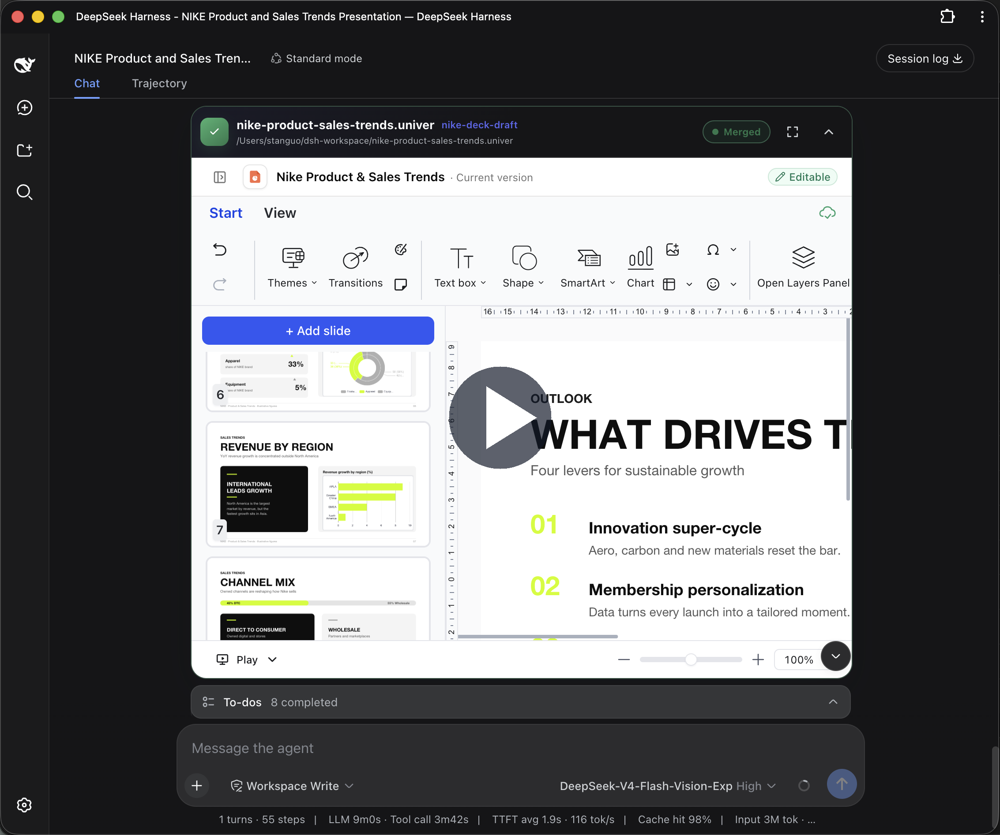
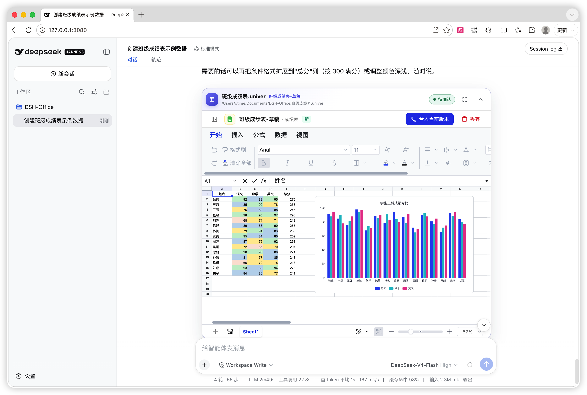
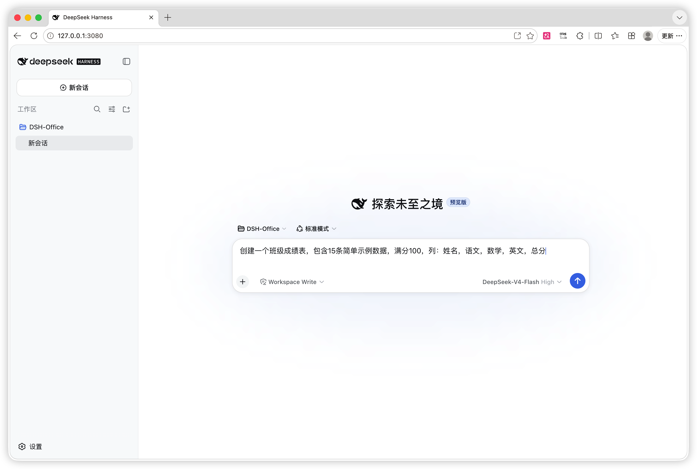
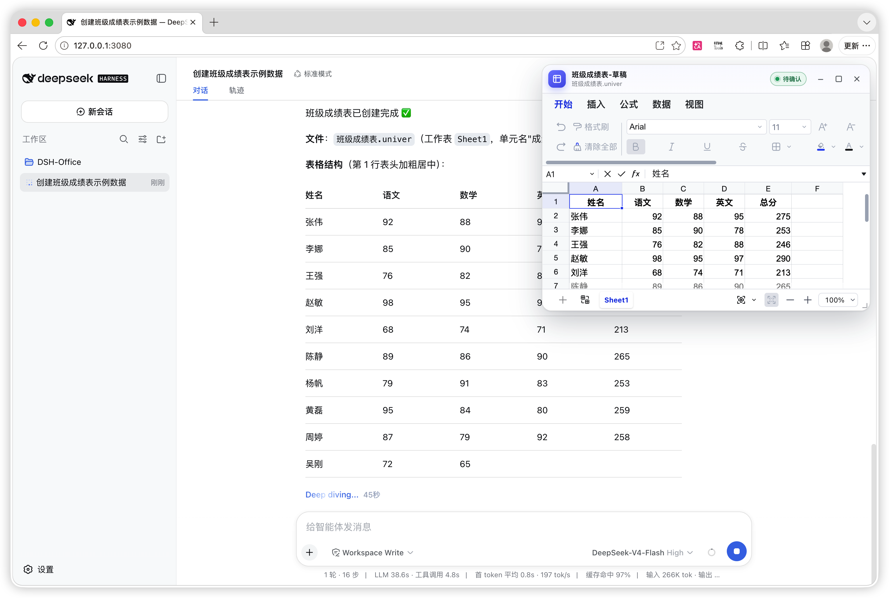
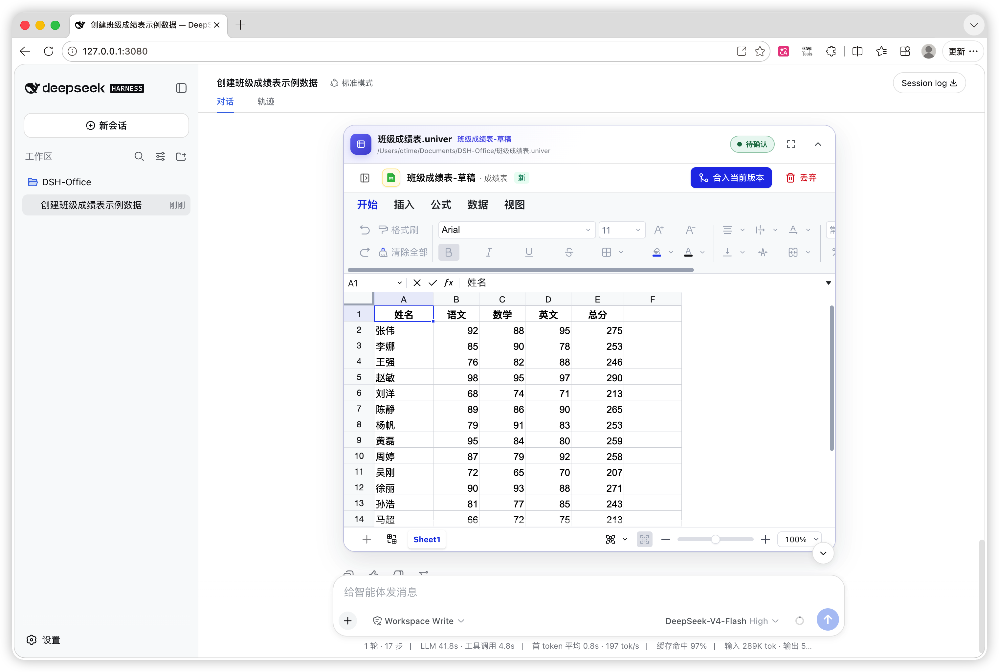
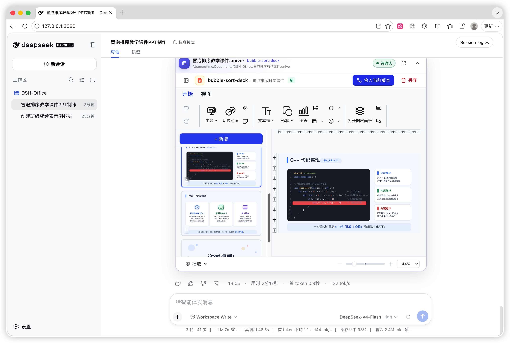

# DSH × Univer Office

> Give DeepSeek Harness a real office environment.
>
> Univer Office Plugin brings spreadsheets, docs, slides, canvases, relational tables, and more into one runtime — with connected data, validation, versioned changes, and isolated worktrees for multi-agent collaboration.

English · [简体中文](README.zh-CN.md)

[](https://www.npmjs.com/package/dsh-univer-office)
[](package.json)
[](LICENSE)

`dsh-univer-office` is the Univer office plugin for DeepSeek Harness (DSH). Open an existing spreadsheet, document, or presentation and tell the agent what to change: it edits that file on its change branch, verifies every change, and leaves the result in the preview for you to save or discard. You can also work directly with Univer's own multidimensional tables and canvases.

Creating a brand-new Office file from a prompt stays on your deployment's default Office provider. This plugin owns editing and review: anything you open — an Excel, Word, or PowerPoint file, or a `.univer` container — is edited here.

After installation, open a file and describe the result you want in natural language. The agent handles editing and verification while you follow the work live and review the result in the conversation. Deliver spreadsheets as Excel (`.xlsx`), documents as Word (`.docx`), and presentations as PowerPoint (`.pptx`) files when needed.

## See it in action

[](https://www.youtube.com/watch?v=k-2zW_CMiew)


The agent created this spreadsheet from a natural-language request, then added conditional formatting and a chart in the same conversation. The result can be previewed, revised, merged into the current version, or discarded in place.



> **Deliver a standard Excel file:** after review, ask the agent to export the spreadsheet as `.xlsx` so it can be opened and edited in Excel, WPS Office, and other compatible office applications.

<details>
<summary>See the complete workflow from request to review</summary>

### 1. Describe the task in natural language



### 2. Follow the result live while the agent works



### 3. Approve or discard the changes in that same preview



</details>

### Edit a presentation that already exists

Ask your Office provider for a deck, then click the `.pptx` it produced in the conversation. This plugin opens it in the one preview tab on the right edge of the same page, imports it once into a sibling `.univer` container with its own change branch, and keeps that deck as the session's presentation. Describe the changes you want — restructure a page, rewrite copy, adjust colors, replace a picture through an image model, add a chart — and the agent edits that exact Slide Unit on top of the existing deck, verifying each page with structure inspection, lint, and screenshots. The tab stays that same `.pptx` for the whole edit: image generation and other writes refresh it in place, and a regenerated or exported deck is not opened beside it. The preview width resizes by dragging its left edge, and it stays open between messages. Save writes the result back to the original `.pptx`.



> **The file you deliver is the one you opened:** Save writes the edited deck back to that `.pptx`. Image edits and other changes stay on it; the agent does not generate a second presentation for you to open.

## What can it do?

- **Analyze and build spreadsheets** — read or create Excel data, clean fields, write formulas, apply formatting and validation, create tables, charts, pivots, filters, sparklines, conditional formatting, and images, then export the result as `.xlsx`, `.csv`, or `.tsv`.
- **Write and lay out documents** — create paragraphs, rich text, lists, tasks, tables, images, charts, headers, footers, pagination, and page layouts.
- **Revise presentations** — redesign selected pages of an existing deck, edit text, shapes, images, tables, charts, and transitions, then detect off-page, overflowing, and overlapping text.
- **Build lightweight databases** — create Base tables, fields, records, and views with formula fields, filters, sorting, grouping, and Sheet-backed references.
- **Draw editable canvases** — create shapes, text, connectors, images, native charts, and diagrams, with connector and layout analysis.
- **Compose several content types** — one `.univer` file can contain Sheets, Docs, Slides, Bases, and Boards. Formulas and embedded content can reference other content in the same file.
- **Work with Office files** — import `.xlsx`, `.csv`, `.tsv`, `.docx`, and `.pptx`, then export the edited content in the matching format.
- **Review agent changes safely** — every write lands on the file's change branch. Watch changes live, then save or discard them instead of letting the agent overwrite the current version.
- **Compare changes semantically** — switch Compare to inspect Sheet, Doc, Slide, Base, or Board changes side by side against the last saved version; the Viewer also pins two worktree revisions for its own comparison.

### Example requests

```text
Create a simple payroll spreadsheet with employee, base salary, bonus, deduction, gross pay, and net pay columns. Calculate the totals automatically.

Create a six-slide lesson deck about bubble sort. Explain the concept, each comparison pass, pseudocode, and complexity, and check every page for layout problems.

Create a formal weekly project report with an executive summary, this week's progress, a risk table, next week's plan, headers, and footers, then export it as docx.

Create a customer-tracking Base with company, contact, stage, expected value, and next action fields, plus a view grouped by stage.

Create a sales Sheet and a summary Slide in the same .univer file, with the Slide chart reading the Sheet data.
```

## Capabilities

| Content | Create and edit | Verify and review | Import | Export |
| --- | --- | --- | --- | --- |
| Sheet | Cells, formulas, styles, tables, charts, pivots, filters, validation, images, and more | Structured range inspection, recalculation, screenshots, PDF printing, live preview | `.xlsx` `.csv` `.tsv` | `.xlsx` `.csv` `.tsv` |
| Doc | Paragraphs, rich text, lists, tasks, tables, images, charts, headers, footers, pagination | Document readback, page screenshots, PDF printing, live preview | `.docx` | `.docx` |
| Slide | Pages, text, shapes, images, tables, charts, SVG layouts, transitions | Structure inspection, layout lint, screenshots, PDF printing, live preview | `.pptx` | `.pptx` |
| Base | Tables, fields, records, views, formulas, filters, sorting, grouping | Structured data checks, workbench screenshot, live preview | — | `.xlsx` `.csv` `.tsv` |
| Board | Shapes, text, connectors, images, native charts, routing | Element analysis, screenshots, PDF printing, live preview | — | — |

Every content type supports unsaved editing, side-by-side semantic comparison, revision, saving, and discarding. Base and Board support structural verification; Board file export is not yet supported.

## Get started in 3 minutes

### 1. Install the plugin

Supported DSH versions are `0.1.5-rc.3`, `0.1.7-rc.1`, `0.2.0-rc.1`, and `0.2.1-rc.3`.

If DSH is running, first press **Ctrl+C** in the terminal that started it. You can run the installation command while DSH is running, but the current DSH process will not load the new plugin automatically.

Install the plugin from npm:

```sh
dsh plugin --profile web add dsh-univer-office
```

Restart DSH after installation:

```sh
dsh web
```

After DSH starts successfully, refresh the existing DeepSeek Harness browser page with **Cmd+R / Ctrl+R**.

### 2. Describe what you need

```text
Create a monthly expense spreadsheet with dates, categories, amounts, a total, and a few rows of sample data.
```

### 3. Review it in that same preview

- All Univer content opens in one preview tab on the right edge of the same page, for every Unit type: Sheet, Doc, Slide, Base, and Board.
- Drag the preview's left edge to resize it. It stays open between messages, follows unsaved changes and the saved version live, and reopens there — not in a second surface — after you close it.
- Compare against the last saved version, save your changes into it, or discard them from that tab's own toolbar. Those buttons sit in the preview itself, so nothing else pops up to ask for the decision; discard asks for confirmation first.

## How it works

1. Describe the result you want and provide any source files.
2. The agent edits the Univer content on the file's change branch.
3. Follow the live preview and ask for revisions until the result is ready.
4. Click Save to fold the changes into the current version, or Discard to return to the state before them.

Saving and discarding always require an explicit user request.

## Built-in tools

DSH selects these tools automatically; you normally do not need to call them manually.

| Tool | Purpose |
| --- | --- |
| `univer_new` | Create an empty `.univer` file without overwriting an existing file |
| `univer_status` | View a file's content and its unsaved changes |
| `univer_worktree` | Ensure the change branch exists, or save / discard its changes |
| `univer_unit` | Add or remove Sheet, Doc, Slide, Base, or Board content |
| `univer_import` | Import an Office file into a `.univer` file; docx keeps its page setup by default, `docType` selects traditional (default) or modern |
| `univer_inspect` | Read document structure or a selected Sheet range |
| `univer_execute` | Read or edit content through the Univer API |
| `univer_export` | Export Sheet, Doc, Slide, or Base content |
| `univer_lint` | Find off-page, overflowing, and overlapping Slide text |
| `univer_compile_svg` | Add an SVG layout to a Slide with measured text |
| `univer_image_edit` | Replace the image you selected in the preview with a model-generated one |
| `univer_screenshot` | Render supported content as PNG images for review |
| `univer_print_pdf` | Print a Sheet, Doc, Slide, or Board to a workspace PDF file |
| `univer_api` | Find bundled Univer API symbols by keyword and show exact references |
| `univer_resources` | Find and use bundled icons, logos, emoji, and illustrations |

## Preview and review experience

- **On-demand preview from the file tree** — click a `.univer` file in the DSH file tree (or a `.pptx` in the conversation) and it opens in the right-side preview tab. No agent operation is involved, and everything you do with the file happens inside the tab. It registers on DSH's own right sidebar; when the `dsh-better-sidebar` plugin is installed instead, it is registered as one of that plugin's file viewers, because that plugin takes over file addresses.
- **One preview tab, and agent edits land in it** — Sheet, Doc, Slide, Base, and Board all open in that single preview on the right side of the same page, not in a floating dialog, a second panel, or a card inside the conversation. Drag its left edge to resize it; it stays open between messages, follows unsaved changes and the saved version live, and reports its file, branch, and Unit through `univer_status` so follow-up conversation edits that exact target. When the agent changes the file, the same tab is revealed and adopts the new Unit in place; if you closed it, the file reopens there rather than in a second surface.
- **Only two decisions: Save and Discard** — as soon as the file differs from its last saved version, whether you changed it in the preview or the agent did, the toolbar shows **Compare**, **Save**, and **Discard**. Compare shows the content beside the saved version; Save folds the changes into the current version; Discard throws them away and returns to the state before them, after a confirmation popover. There is no submit-for-review, no reopen, and no branch switch: every file has exactly one change branch, all edits land there, and you can keep editing right after saving or discarding.
- **A presentation stays the deck you opened** — the tab for a `.pptx` is always that file, never the `.univer` container behind it and never a second deck an image model or export just produced. Agent writes, including generated pictures, refresh the same tab in place. Save writes the deck back to the original `.pptx`, keeping the previous version as `<name>.pptx.bak` beside it; if the write fails (PowerPoint holding the file open, for example) the changes stay unsaved so you can retry. Discard takes back only the agent's changes: edits you made in the preview before the agent touched the deck are kept. A deck edited on disk outside this plugin is re-imported when you open it again, so the preview never drifts from the file.
- **Edit in place inside the preview** — the toolbar's Editable mark states that you can click straight into the page and change text, shapes, and cells; edits are written through the collaboration channel onto that branch as new revisions. Diff is always read-only.
- **Edit the picture you selected** — select an image on a slide in the preview and ask the agent to change or replace it. The prompt goes to an image model together with the image's own bytes, the generated result is written back onto that branch, and the image keeps its position, size, rotation, and stacking. The result is embedded in the deck, so it does not depend on the model's short-lived download link. Saving and discarding work exactly as for any other edit.
- **Close guard, and no save on exit** — closing the preview tab's × while changes are unsaved does not drop them silently: the tab stays open and asks **Save and close / Discard and close / Cancel** inside the preview. Leaving DSH or closing the browser writes nothing; the next open starts from the last saved version.
- **Pinned worktree comparison** — the Viewer itself still compares any worktree against trunk with both sides pinned, changed entities navigable, and a refresh control when either side advances. The preview toolbar's Compare needs only one target: the last saved version.
- **Responsive review toolbar** — controls stay centered when space permits and share a compact row that wraps in order as the preview narrows. The title shows the selected document name; long names truncate, and action status messages remain visible.
- **Historical review** — saves and discards stay recorded on the file; the preview always reflects the current authoritative status instead of stacking per-turn cards in the conversation.
- **Session isolation** — each DSH session shows only its own preview target, width, and review state.
- **English and Chinese UI** — the plugin shell and every open Viewer follow the DSH locale.
- **Import, export, and print** — the current version can import Office files, export supported content, and print from the Univer Ribbon. Draft and review previews do not allow import or export; Board provides print only.
- **Version history for all five Unit types** — current Sheet, Doc, Slide, Base, and Board views show time-grouped history. Read-only views can inspect versions, while editable views can restore one explicitly.

## Requirements and current limits

- DeepSeek Harness and Node.js `>=22.19.0`.
- The file-tree preview needs no extra plugin: it registers a tab type on DSH's right sidebar and claims `dsh-resource://file/**` addresses ending in `.univer` or `.pptx`. While `dsh-better-sidebar` (`^0.19.0`) is installed it takes over file addresses at the same priority with a broader pattern, so the preview is registered as one of its file viewers instead — both shapes are covered, and only one ever applies. Clicking a `.pptx` claims the address here, so PowerPoint files no longer fall through to the built-in preview.
- Older `.univer` files are automatically upgraded to format v3 when opened. A backup is saved beside the original; migration and validation run on a temporary copy, which replaces the original only after success. Failed upgrades leave the original unchanged. Opening the same unchanged file again reuses that backup instead of writing another copy.
- Screenshots, PDF printing, Slide layout checks, and SVG text measurement need a local Chromium-family browser. Chrome/Chromium and Microsoft Edge are detected automatically; set the `browserExecutablePath` option or the `UNIVER_RENDER_BROWSER` environment variable to point at a specific executable (for example Edge on Windows).
- Slide master pages, layout pages, and speaker notes are outside the current editing scope.
- Board mind maps, tables, ink, advanced editing, and file export are not yet supported.
- While bundled task guidance is enabled, the plugin registers its own `univer*` skills for editing content you opened. It never shadows DSH's built-in `office`, `office-docx`, `office-xlsx`, or `office-pptx` skills, so creating a brand-new Word, Excel, or PowerPoint file from a prompt keeps following the deployment default (for example python-docx, openpyxl, or python-pptx) instead of routing here. Set `skills: false` to disable this plugin's guidance.

## Configuration

The defaults are designed for local use: the service starts at port `9080`. If that port is occupied, it tries `9081`, then continues upward one port at a time. Set these plugin options when you need different values:

| Field | Default | Purpose |
| --- | --- | --- |
| `gatewayPort` | `9080` | Initial loopback service port; occupied ports advance by one |
| `autoStartGateway` | `true` | Start the service on first use |
| `gatewayStartupTimeoutMs` | `10000` | Service startup timeout |
| `gatewayRequestTimeoutMs` | `3000` | State-read timeout |
| `gatewayMutationTimeoutMs` | `60000` | Write-operation timeout |
| `unitContentOperationTimeoutMs` | `120000` | Import, export, inspection, and execution timeout |
| `unitContentRuntimeMaxEntries` | `20` | Unit runtimes kept warm for inspection, execution, and rendering. When all are busy, further operations fail with `COLLABORATION_POOL_CAPACITY_EXCEEDED`. `0` starts a new process for every operation |
| `unitContentRuntimeIdleTtlMs` | `300000` | Idle time after which a warm Unit runtime exits |
| `screenshotOperationTimeoutMs` | `120000` | Overall timeout for one browser screenshot operation |
| `printPdfOperationTimeoutMs` | `120000` | Overall timeout for one browser PDF print operation |
| `screenshotMaxPages` | `30` | Maximum Doc or Slide pages rendered by one screenshot call |
| `screenshotMaxPixels` | `16777216` | Maximum pixel count for each screenshot image |
| `browserExecutablePath` | auto-detected | Browser executable for screenshots, PDF printing, and Slide checks; takes precedence over `UNIVER_RENDER_BROWSER` |
| `resourceCacheRoot` | `$DSH_HOME/cache/dsh-univer-office/resources` | Persistent downloaded-SVG cache; falls back to `~/.dsh` when `DSH_HOME` is unset |
| `resourceDownloadTimeoutMs` | `15000` | Timeout for one SVG resource download |
| `resourceOperationTimeoutMs` | `120000` | Overall timeout for one resource-library tool operation |
| `tools` | `true` | Enable agent editing capabilities |
| `skills` | `true` | Enable bundled task guidance |
| `imageApiKey` | `ARK_API_KEY` | Volcengine Ark API key for image editing; `univer_image_edit` stays available without one and answers `IMAGE_API_KEY_MISSING` |
| `imageModel` | `doubao-seedream-5-0-pro-260628` | Image model the Ark account must have activated |
| `imageEndpoint` | Ark `images/generations` URL | Absolute HTTP(S) image generation endpoint |
| `imageSize` | `1K` | Requested output size class: `1K`, `2K`, or `4K` |
| `imageOperationTimeoutMs` | `180000` | Overall timeout for one image generation request, including the result download |
| `telemetry` | `true` | Send anonymous product telemetry |

The Viewer, its HTTP API, and its WebSocket collaboration traffic are served by the plugin on the DSH WebServer origin itself (`/univer-viewer/...` and `/uf/...`), so remote deployments work through whatever entry already fronts DSH — no extra reverse-proxy configuration. Every browser request passes DSH browser authentication via the `connection` service. Viewer document opens and `/univer-api` requests also validate the named session workspace; subsequent `/uf` API and WebSocket requests do not require a plugin session cookie or repeat that workspace check. Authenticated browsers can address any `.univer` file accessible to the Host process, including in remote deployments. In DSH Desktop, the Viewer obtains the current Host loopback address through an authenticated runtime endpoint for WebSocket connections; HTTP requests continue through the desktop shell. The Gateway itself stays on loopback and is never exposed. (The former `viewerBaseUrl` option was removed by this change and is ignored.)

## Telemetry

Sends anonymous usage stats after the plugin activates (never file contents or paths). The published package declares no `postinstall` script. Disable telemetry with `DO_NOT_TRACK=1` or `telemetry: false`.

## Uninstall

```sh
dsh plugin --profile web remove dsh-univer-office
```

## Development

This project is a standard [DSH bundle](https://github.com/deepseek-ai/deepseek-harness/blob/main/docs/user/develop/basic/publish.md). Its Host composes the Univer Service Provider, Tools Consumer, webServer Consumer, and Skill Provider. The bundle includes its Gateway, Viewer, pooled Collaboration Runtime Workers, headless Unit Content Worker, and Slide render machine. See the [architecture document](docs/architecture.md) for dependency directions and runtime boundaries.

The project requires Node.js `>=22.19.0` and `pnpm@11.23.0`.

```sh
pnpm install
pnpm run lint
pnpm run typecheck
pnpm run build
pnpm run test
```

`.npmrc` resolves the `@univer-cli`, `@univerjs`, and `@univerjs-pro` scopes from Univer's insider registry, `https://insider-npm-registry.univer.work/`. The registry is public and needs no account or token. It is mainly for installing Univer insider builds; install official releases from npm.

## Official package name

Install only `dsh-univer-office`. The following similar names are deprecated npm placeholders reserved by this project to prevent impersonation; they contain no plugin code:

- `dsh-univer-plugin`
- `dsh-univer-office-suite`
- `dsh-univer-suite`
- `univer-office-suite`
- `univer-office`

## License

[Apache-2.0](LICENSE)
