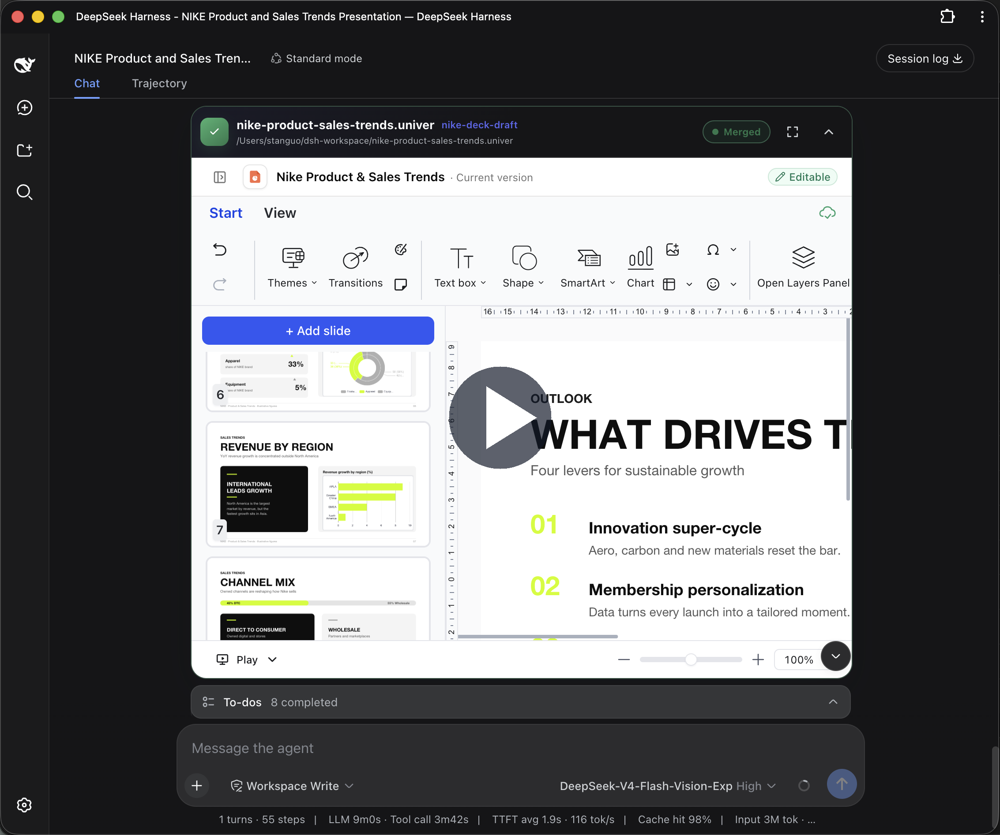
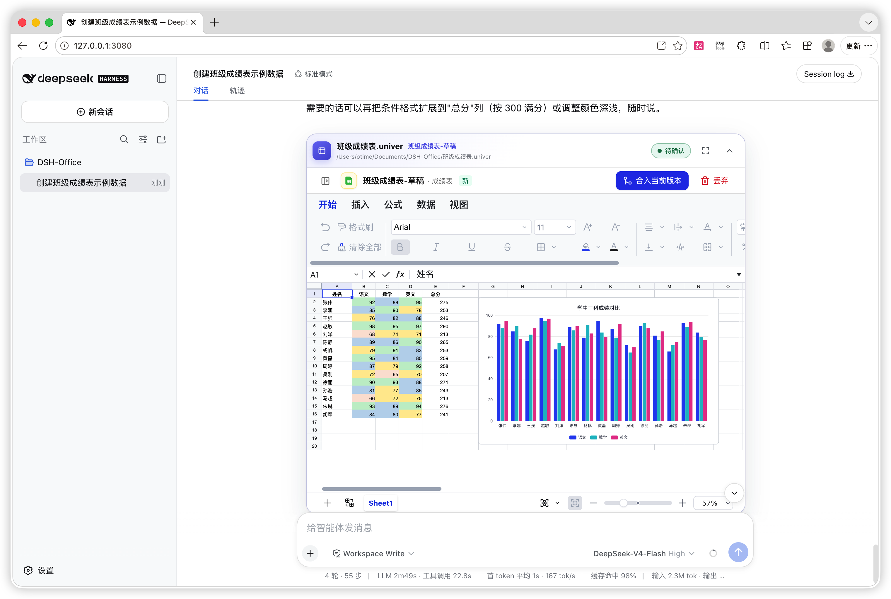
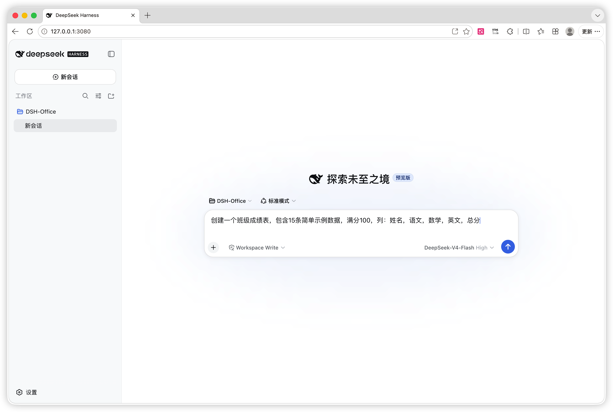
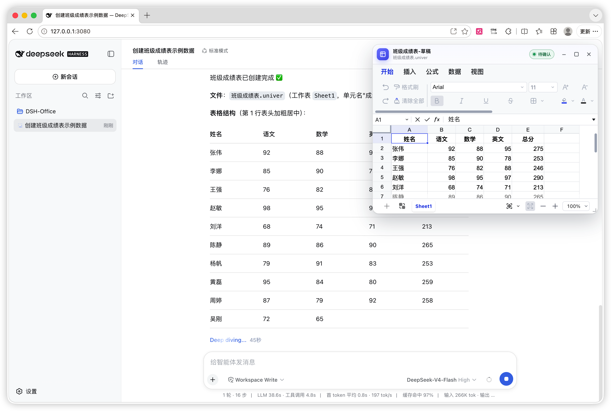
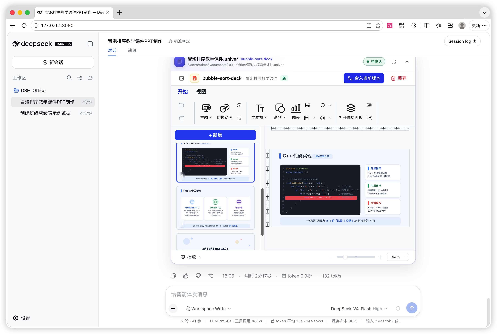

# DSH × Univer Office

> 为 DeepSeek Harness 打造一个真正的办公环境。
>
> Univer Office 插件将电子表格、文档、幻灯片、画布、多维表格等汇聚到同一个运行时——数据互联、修改经过校验、变更按版本管理，并以隔离工作树支持多 Agent 协作。

[English](README.md) · 简体中文

[](https://www.npmjs.com/package/dsh-univer-office)
[](package.json)
[](LICENSE)

`dsh-univer-office` 是 DeepSeek Harness（DSH）的 Univer 办公插件。打开一个已有的电子表格、文档或演示文稿，再告诉 Agent 要改什么：它会在这个文件的改动分支里修改内容、校验每处改动，并让你在右侧预览页里直接保存或丢弃。你也可以直接使用 Univer 原生的多维表格与画布。

从一句话全新生成 Office 文件仍由部署默认的 Office 通道负责。本插件负责编辑与审阅：你打开的 Excel、Word、PowerPoint 文件或 `.univer` 容器，都在这里编辑。

安装后，打开文件并用自然语言描述目标即可。Agent 会完成编辑和校验，你可以在会话中实时查看过程、审阅结果，并把电子表格导出为 Excel（`.xlsx`），或按需交付 Word（`.docx`）和 PowerPoint（`.pptx`）文件。

## 看看实际效果

[](https://www.youtube.com/watch?v=k-2zW_CMiew)


下面的电子表格由 Agent 根据自然语言要求创建，并在同一个会话中继续添加条件格式和图表。完成后可以直接预览、继续修改，再一键保存到当前版本或丢弃这次修改。



> **可以直接交付 Excel 文件：** 审阅完成后，让 Agent 将电子表格导出为 `.xlsx`，即可使用 Excel、WPS Office 等常见办公软件继续打开和编辑。

<details>
<summary>查看从提出需求到审阅结果的完整过程</summary>

### 1. 用自然语言描述任务



### 2. 修改过程中实时查看结果



### 3. 在右侧预览页中保存或丢弃修改

- 所有 Univer 内容都在同一页面右侧的同一个预览页中打开，覆盖 Sheet、Doc、Slide、Base 和 Board 全部类型。
- 拖动预览页左边缘即可改变宽度；它跨消息保持打开，并实时跟随未保存的改动与已保存的版本。
- 在预览页工具栏里可以切到「对比已保存版本」，出现未保存改动时会同时出现「保存」和「丢弃」：保存把改动合入当前版本，丢弃先弹确认气泡再回到修改前的状态。

</details>

### 编辑已有的演示文稿

先让 Office 通道生成演示文稿，然后在聊天记录里点击它产出的 `.pptx`。本插件会把这份文稿在同一页面右侧的那一个预览页中打开，将它导入同目录的 `.univer` 容器，并把它设为当前会话的演示文稿。此后这个标签页始终是这份 `.pptx`，容器只是它的缓存：接下来描述你要做的修改——重排某一页、改写文案、调整配色、添加图表——Agent 会在这份已有文稿的 Slide Unit 上修改，并逐页做结构检查、布局检查和截图校验，结果原地刷新在同一个标签页里。预览页左边缘可左右拖动改变宽度，跨消息保持打开。点「保存」会把结果写回原始 `.pptx`。



> **可以直接交付 PowerPoint 文件：** 审阅完成后，让 Agent 将演示文稿导出为 `.pptx`，即可使用 PowerPoint、WPS Office 等常见办公软件继续播放和编辑。

## 你可以让它做什么

- **分析和制作表格**：读取或创建 Excel 数据，清洗字段，编写公式，设置格式、数据验证和条件格式，创建表格、图表、透视表、筛选器、迷你图与图片，最后导出为 `.xlsx`、`.csv` 或 `.tsv`。
- **撰写和排版文档**：创建段落、富文本、列表、任务、表格、图片、图表、页眉页脚、分页与页面布局。
- **修改演示文稿**：重设计已有文稿的指定页面，编辑文字、形状、图片、表格、图表与转场，并检查越界、溢出和文本重叠。
- **搭建多维表格**：创建表、字段、记录和视图，使用公式字段、筛选、排序、分组及 Sheet 数据引用。
- **绘制可编辑画布**：创建形状、文本、连接线、图片、原生图表和流程图，并检查连接关系与布局。
- **组合多种内容**：一个 `.univer` 文件可以同时包含 Sheet、Doc、Slide、多维表格（Base）和 Board；公式或嵌入内容可以引用同一文件中的其他内容。
- **处理 Office 文件**：导入 `.xlsx`、`.csv`、`.tsv`、`.docx`、`.pptx`，修改后按对应格式导出。
- **安全审阅 Agent 修改**：所有写入先留在文件的改动分支里。你可以实时预览并对比已保存版本，再选择保存或丢弃，Agent 不会直接覆盖当前版本。
- **按语义比较修改**：切到「对比已保存版本」，即可将 Sheet、Doc、Slide、Base 或 Board 与上一次保存的版本并排审阅；Viewer 自身也支持固定两个 worktree 版本对照。

### 试试这些任务

```text
帮我做一个简单的工资计算表，包含员工、基本工资、奖金、扣款、应发工资和实发工资，自动计算汇总结果。

帮我做一个冒泡排序的幻灯片课件，用 6 页讲清楚原理、逐轮比较过程、伪代码和复杂度，每页完成布局检查。

帮我创建一份正式的项目周报文档，包含执行摘要、本周进展、风险表、下周计划和页眉页脚，最后导出 docx。

创建一个客户跟进多维表格，包含公司、联系人、阶段、预计金额和下次行动，并提供按阶段分组的视图。

在同一个 .univer 文件里创建销售数据 Sheet 和汇报 Slide，让 Slide 图表引用 Sheet 数据。
```

## 能力一览

| 内容类型 | 创建与编辑 | 校验与审阅 | 导入 | 导出 |
| --- | --- | --- | --- | --- |
| Sheet | 单元格、公式、样式、表格、图表、透视表、筛选、验证、图片等 | 结构化范围检查、公式重算、截图、PDF 打印、实时预览 | `.xlsx` `.csv` `.tsv` | `.xlsx` `.csv` `.tsv` |
| Doc | 段落、富文本、列表、任务、表格、图片、图表、页眉页脚、分页 | 文档结构回读、逐页截图、PDF 打印、实时预览 | `.docx` | `.docx` |
| Slide | 页面、文字、形状、图片、表格、图表、SVG 布局、转场 | 结构检查、布局检查、截图、PDF 打印、实时预览 | `.pptx` | `.pptx` |
| 多维表格（Base） | 表、字段、记录、视图、公式字段、筛选、排序、分组 | 结构化数据检查、工作台截图、实时预览 | — | `.xlsx` `.csv` `.tsv` |
| Board | 形状、文字、连接线、图片、原生图表、自动布线 | 元素分析、截图、PDF 打印、实时预览 | — | — |

所有类型都支持未保存改动、并排语义比较、继续修改、保存或丢弃。多维表格和 Board 支持结构校验；Board 暂不支持文件导出。

## 3 分钟上手

### 1. 安装插件

支持的 DSH 版本为 `0.1.5-rc.3`、`0.1.7-rc.1`、`0.2.0-rc.1` 和 `0.2.1-rc.3`。

如果 DSH 正在运行，先在启动它的终端按 **Ctrl+C** 停止进程。运行中可以执行安装命令，但当前 DSH 进程不会自动加载新插件。

从 npm 安装插件：

```sh
dsh plugin --profile web add dsh-univer-office
```

安装完成后重新启动 DSH：

```sh
dsh web
```

DSH 启动成功后，在已有的 DeepSeek Harness 浏览器页面按 **Cmd+R / Ctrl+R** 刷新。

### 2. 直接描述需求

```text
帮我生成一个月度支出表格，包含日期、分类、金额和合计，并填入几条示例数据。
```

### 3. 在右侧预览页中审阅

- Agent 工作时，修改会实时出现在同一页面右侧的那一个预览页里，并避开桌面标题栏。
- 拖动预览页左边缘即可调整宽度；它跨消息保持打开，关闭后再次修改会重新打开同一个预览页。
- 继续修改、对比、保存或丢弃都可以直接在这个预览页的工具栏中完成，不会再另开页面让你确认。

## 工作方式

1. 描述目标，并提供需要处理的源文件。
2. Agent 在文件的改动分支里编辑 Univer 内容。
3. 通过实时预览查看结果，并继续提出修改要求。
4. 点「保存」把这些改动合入当前版本，或点「丢弃」回到修改前的状态。

确认和放弃都必须由用户明确提出。

## 内置工具

DSH 会自动选择这些工具，日常使用不需要手动调用。

| 工具 | 作用 |
| --- | --- |
| `univer_new` | 创建空 `.univer` 文件，不覆盖已有文件 |
| `univer_status` | 查看文件内容与未保存改动 |
| `univer_worktree` | 确保改动分支存在，或保存 / 丢弃它的改动 |
| `univer_unit` | 添加或删除 Sheet、Doc、Slide、多维表格或 Board 内容 |
| `univer_import` | 把 Office 文件导入 `.univer` 文件；docx 默认保留页面设置，`docType` 可选 traditional（默认）或 modern |
| `univer_inspect` | 读取文档结构或指定 Sheet 范围 |
| `univer_execute` | 通过 Univer API 读取或编辑内容 |
| `univer_export` | 导出 Sheet、Doc、Slide 或多维表格内容 |
| `univer_lint` | 检查 Slide 文字越界、溢出和重叠 |
| `univer_compile_svg` | 将 SVG 布局按文字度量添加到 Slide |
| `univer_image_edit` | 用模型生成的图片替换你在预览页中选中的图片 |
| `univer_screenshot` | 把支持的内容渲染为 PNG 图片供审阅 |
| `univer_print_pdf` | 把 Sheet、Doc、Slide 或 Board 打印为 workspace 中的 PDF 文件 |
| `univer_api` | 按关键词查找插件内置的 Univer API 符号并查看精确引用 |
| `univer_resources` | 查找和使用内置图标、Logo、Emoji 与插画 |

## 预览与审阅体验

- **文件树按需预览**：在 DSH 文件树中点击 `.univer` 文件（或在聊天记录中点击 `.pptx`）即可在右侧预览页中打开。整个过程不需要 Agent 执行任何操作。打开时的内容与编辑都集中在这一个预览页内。该入口直接注册在 DSH 自带的右侧栏上；若安装了 `dsh-better-sidebar`，由于该插件会接管文件地址，预览会改为注册成它的文件预览器。
- **只有这一个预览页**：Sheet、Doc、Slide、Base 和 Board 都在同一页面右侧的同一个预览页里打开，既不使用悬浮对话框，也不另开面板或回执页，更不在聊天主对话里渲染预览卡片。拖动左边缘即可改变宽度，它跨消息保持打开，并实时跟随保存版本与未保存改动；打开期间 `univer_status` 会报告它的文件、分支与 Unit，后续关于该内容的对话会直接继续编辑它。Agent 修改同一文件时只会揭示并更新这一个预览页；你关掉它之后再修改，仍在这一页重新打开。
- **只有「保存」和「丢弃」两个决定**：只要文件和上一次保存相比有改动（你自己在预览页里改的，或者 Agent 改的），工具栏就会出现「对比已保存版本」「保存」「丢弃」。对比把当前内容与上一次保存的版本并排显示；「保存」把这些改动合入当前版本；「丢弃」丢掉本次改动、回到修改前的状态（会先弹确认气泡）。没有「提交待审」「重新打开」或分支切换——每个文件只有一条改动分支，所有操作都发生在它上面，保存或丢弃之后马上可以继续编辑。
- **演示文稿始终是用户打开的那份 `.pptx`**：这个标签页不会换成背后的 `.univer` 容器，Agent 的修改原地刷新在同一页里。点「保存」会把文稿导出并写回原始 `.pptx`，替换前把上一版留在旁边的 `<文件名>.pptx.bak`；写不进去时（例如 PowerPoint 正占用该文件）改动保持未保存，可以关掉程序再重试。「丢弃」只回退 Agent 的改动：Agent 动手之前你自己在预览页里改过的内容会保留。磁盘上的文稿被重新生成或被其他程序编辑后，再次打开会先重新导入，因此预览始终与文件一致。
- **预览页内实时编辑**：工具栏的「可编辑」标记表示可以直接点进页面编辑文字、形状与表格，修改通过协作通道实时写入这条分支并累积为新的 revision。对比视图始终只读。
- **直接替换选中的图片**：在预览页里选中幻灯片上的一张图片，然后让 Agent 改它或换掉它。这段文字会和图片本身的字节一起交给图片模型，生成结果写回同一条分支，图片的位置、大小、旋转与层级保持不变。结果会内嵌到演示文稿中，不依赖模型返回的临时下载链接。保存与丢弃的行为和其他修改完全一致。
- **关闭前提醒，退出不保存**：用标签页的 × 关闭预览且还有未保存改动时，DSH 不会直接关闭标签页，而是在预览页内弹出「保存并关闭 / 丢弃并关闭 / 取消」确认条。直接退出 DSH 或关闭浏览器时，未保存的改动不会被写入；下次打开该文件会回到上一次保存的版本。
- **固定版本的 worktree 比较**：Viewer 自身仍支持把任意 worktree 与主线并排查看并固定两侧版本；预览页工具栏的对比只需要一个目标，即上一次保存的版本。
- **响应式审阅工具栏**：空间充足时控件居中，预览页变窄后按顺序换行；标题显示当前文档名，超长名称截断，操作状态提示保持可见。
- **历史审阅**：保存、丢弃结果都记录在文件上；预览页始终反映当前权威状态，不再在主对话里堆叠按回合生成的卡片。
- **多会话隔离**：每个 DSH 会话只展示自己的预览目标、宽度和审阅状态。
- **中英文界面**：插件外壳和已打开的 Viewer 跟随 DSH 的界面语言。
- **导入、导出与打印**：当前版本可通过 Univer Ribbon 导入 Office 文件、导出受支持的内容并打印。未保存的改动不开放导入导出；Board 仅提供打印。
- **五类 Unit 版本历史**：当前版本的 Sheet、Doc、Slide、Base 和 Board 均可查看按时间聚合的历史。只读视图可以查看版本，可编辑视图可以显式恢复。

## 要求与限制

- DeepSeek Harness，以及 Node.js `>=22.19.0`。
- 文件树预览不需要额外插件：它在 DSH 自带右侧栏注册一个 tab 类型，认领以 `.univer` 或 `.pptx` 结尾的 `dsh-resource://file/**` 地址。安装 `dsh-better-sidebar`（`^0.19.0`）期间，该插件会以同档位、更宽的模式接管文件地址，因此预览改为注册成它的文件预览器——两种宿主形态都覆盖，且任一时刻只有一条生效。点击 `.pptx` 时该地址由本插件认领，不再落到内置预览。
- 打开旧版 `.univer` 文件时会自动升级到 v3 格式：先在原文件旁保存备份，在临时副本中完成迁移和验证，成功后才替换原文件；升级失败时原文件保持不变。再次打开同一份未变化的文件时复用这份备份，不会再复制一份。
- 截图、PDF 打印、Slide 布局检查和 SVG 文字度量需要本机 Chromium 系浏览器。Chrome/Chromium 与 Microsoft Edge 会被自动探测；也可以通过 `browserExecutablePath` 配置项或 `UNIVER_RENDER_BROWSER` 环境变量指定浏览器可执行文件路径（例如 Windows 上的 Edge）。
- Slide 的母版、版式页和演讲者备注不在当前编辑范围内。
- Board 的思维导图、表格、墨迹和高级编辑，以及 Board 文件导出尚未开放。
- 启用内置任务指引时，插件只注册自己的 `univer*` 技能，用于编辑你已打开的内容。它不会覆盖 DSH 自带的 `office`、`office-docx`、`office-xlsx` 和 `office-pptx` 技能，因此从一句话全新创建 Word、Excel 或 PowerPoint 文件仍走部署默认通道（例如 python-docx、openpyxl 或 python-pptx），不会路由到这里。设置 `skills: false` 可关闭本插件的任务指引。

## 配置

默认配置适合本地使用：服务从端口 `9080` 启动；若该端口被占用，则依次尝试 `9081`、`9082`。如需定制，可设置以下插件选项：

| 字段 | 默认值 | 说明 |
| --- | --- | --- |
| `gatewayPort` | `9080` | 本地服务起始端口；被占用时逐次加一 |
| `autoStartGateway` | `true` | 首次访问时自动启动服务 |
| `gatewayStartupTimeoutMs` | `10000` | 服务启动超时 |
| `gatewayRequestTimeoutMs` | `3000` | 状态读取超时 |
| `gatewayMutationTimeoutMs` | `60000` | 写操作超时 |
| `unitContentOperationTimeoutMs` | `120000` | 导入、导出、检查和执行超时 |
| `unitContentRuntimeMaxEntries` | `20` | 为检查、执行和渲染保持预热的 Unit runtime 数；全部忙碌时后续操作返回 `COLLABORATION_POOL_CAPACITY_EXCEEDED`；`0` 表示每次操作都启动新进程 |
| `unitContentRuntimeIdleTtlMs` | `300000` | 预热的 Unit runtime 空闲多久后退出 |
| `screenshotOperationTimeoutMs` | `120000` | 一次浏览器截图操作的总超时 |
| `printPdfOperationTimeoutMs` | `120000` | 一次浏览器 PDF 打印操作的总超时 |
| `screenshotMaxPages` | `30` | 一次 Doc 或 Slide 截图最多渲染的页数 |
| `screenshotMaxPixels` | `16777216` | 每张截图允许的最大像素数 |
| `browserExecutablePath` | 自动探测 | 截图、PDF 打印和 Slide 检查使用的浏览器可执行文件；设置后优先于 `UNIVER_RENDER_BROWSER` |
| `resourceCacheRoot` | `$DSH_HOME/cache/dsh-univer-office/resources` | 下载 SVG 资源的持久缓存目录；未设置 `DSH_HOME` 时使用 `~/.dsh` |
| `resourceDownloadTimeoutMs` | `15000` | 单个 SVG 资源下载超时 |
| `resourceOperationTimeoutMs` | `120000` | 一次资源库工具操作的总超时 |
| `tools` | `true` | 启用 Agent 编辑能力 |
| `skills` | `true` | 启用内置任务指引 |
| `imageApiKey` | `ARK_API_KEY` | 图片编辑使用的火山方舟 API Key；未设置时 `univer_image_edit` 仍然可用，调用返回 `IMAGE_API_KEY_MISSING` |
| `imageModel` | `doubao-seedream-5-0-pro-260628` | 图片模型；方舟账号需已开通该模型 |
| `imageEndpoint` | 方舟 `images/generations` 地址 | 图片生成接口的绝对 HTTP(S) 地址 |
| `imageSize` | `1K` | 请求的输出尺寸档位：`1K`、`2K` 或 `4K` |
| `imageOperationTimeoutMs` | `180000` | 一次图片生成请求（含结果下载）的总超时 |
| `telemetry` | `true` | 发送匿名产品遥测 |

Viewer 页面、HTTP API 与 WebSocket 协作流量由插件直接挂载在 DSH WebServer origin 上（`/univer-viewer/...` 与 `/uf/...`），远程部署沿用现有 DSH 访问入口即可，无需额外反向代理配置。每个浏览器请求均通过 `connection` 服务完成 DSH 浏览器鉴权。Viewer 文档打开与 `/univer-api` 请求还会校验指定会话的 workspace；后续 `/uf` API 与 WebSocket 请求不依赖插件会话 cookie，也不重复 workspace 校验。已通过鉴权的浏览器可以寻址 Host 进程有权访问的任意 `.univer` 文件，远程部署也采用相同规则。在 DSH 桌面端，Viewer 通过受鉴权保护的运行时接口获取当前 Host loopback 地址，用于 WebSocket 连接；HTTP 请求仍由桌面壳转发。Gateway 始终只监听 loopback，不对外暴露。（原 `viewerBaseUrl` 配置已随本次变更移除，保留时会被忽略。）

## 遥测

插件激活后默认发送匿名使用统计（不含文件内容与路径），发布包不声明 `postinstall` 脚本。设 `DO_NOT_TRACK=1` 或配置 `telemetry: false` 关闭遥测。

## 卸载

```sh
dsh plugin --profile web remove dsh-univer-office
```

## 开发

本项目是一个标准 [DSH bundle](https://github.com/deepseek-ai/deepseek-harness/blob/main/docs/user/develop/basic/publish.md)。Host 组合 Univer Service Provider、Tools Consumer、webServer Consumer 和 Skill Provider；插件自带 Gateway、Viewer、池化 Collaboration Runtime Worker、无头 Unit Content Worker 与 Slide render machine。依赖方向和运行时边界见[架构文档](docs/architecture.md)。

项目要求 Node.js `>=22.19.0` 和 `pnpm@11.23.0`。

```sh
pnpm install
pnpm run lint
pnpm run typecheck
pnpm run build
pnpm run test
```

`.npmrc` 让 `@univer-cli`、`@univerjs`、`@univerjs-pro` 三个 scope 从 Univer 的 insider registry（`https://insider-npm-registry.univer.work/`）解析。该源对外公开，不需要账号或 token，主要用于访问 Univer 的 insider 版本；正式版本推荐从 npm 下载安装。

## 官方包名

请只安装 `dsh-univer-office`。以下相似名称是本项目为防止仿冒而保留的 deprecated npm 占位包，不包含插件代码：

- `dsh-univer-plugin`
- `dsh-univer-office-suite`
- `dsh-univer-suite`
- `univer-office-suite`
- `univer-office`

## 许可

[Apache-2.0](LICENSE)
